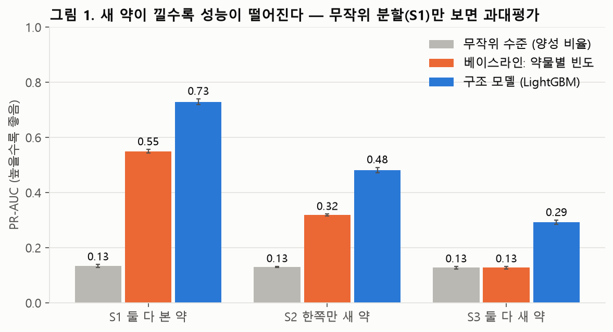
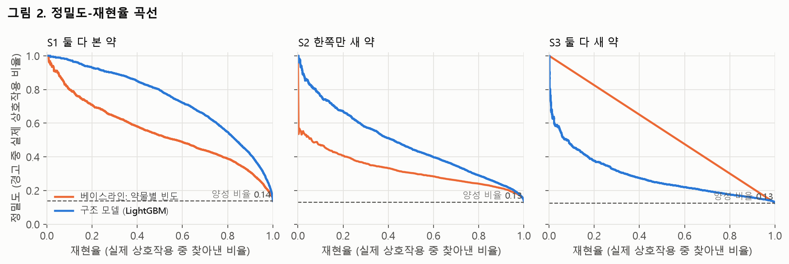

# 필체크 (PillCheck)

여러 약을 함께 복용할 때의 위험을 출처가 붙은 규칙 데이터로 확인하는 서비스. 병용금기, 성분 중복, 다제약물, 노인주의를 한 번에 점검하고, 위험이 확인되면 가까운 약국·병원 상담으로 연결함.

표기 규칙: 수치 뒤의 (코드)는 저장소 안의 데이터·결과 파일이나 스크립트 실행으로 확인한 값, (기록)은 문서에만 남아 있고 저장소 안에 계산 결과 파일이 없는 값임.

## 배경

- 감기약, 두통약처럼 흔한 약에도 아세트아미노펜 같은 성분이 겹쳐 들어 있어, 여러 개를 함께 먹으면 하루 최대량을 넘길 수 있음.
- 복용약이 늘수록 상호작용 조합이 빠르게 늘어남(3개는 3쌍, 5개는 10쌍). 고령자는 벤조디아제핀, NSAIDs 같은 약에서 낙상·출혈 위험이 커짐.
- 일반 사용자는 성분명을 모르고 "혈압약", "타이레놀"처럼 말함. LLM 챗봇에 물으면 근거 없는 상호작용을 만들어 낼 위험이 있음.
- 그래서 입력은 일상어로 받고, 판정은 LLM이 아니라 출처가 붙은 규칙 데이터가 하며, 근거와 출처를 함께 보여 주는 도구로 설계함.

## 데이터

### 출처

| 구분 | 출처 | 용도 |
| --- | --- | --- |
| 병용금기·노인주의·임부금기 | [식약처 DUR 품목정보 OpenAPI](https://www.data.go.kr/data/15059486/openapi.do), [의약품 제품 허가정보](https://www.data.go.kr/data/15095677/openapi.do) | 제품을 품목기준코드로 변환(허가정보)한 뒤 병용금기·주의를 실시간 조회해 보강. `use_dur` 옵션, 키는 서버에서만 사용 |
| 병용금기 약물 목록 | [한국의약품안전관리원 병용금기약물](https://www.data.go.kr/data/15089525), [심평원 DUR 목록](https://www.data.go.kr/data/15127983) | DUR 검증 대조 |
| 제품명에서 성분으로 | [식약처 의약품안전나라](https://nedrug.mfds.go.kr), e약은요, 제품허가정보 API | 제품명 매핑, 미등재 제품 실시간 조회 |
| 상호작용 근거 | [약학정보원](https://www.health.kr) | 상호작용 규칙의 근거 문헌 |
| 고령자 주의 약물 | [AGS Beers Criteria 2023](https://doi.org/10.1111/jgs.18372) | 노인주의 축 |
| 질환-음식·영양 | 대한소화기학회, 대한당뇨병학회, 한국형 통풍 진료지침 등 | 영양 안내 |
| 구조 기반 예측 실험 | [Therapeutics Data Commons, DrugBank DDI](https://tdcommons.ai/multi_pred_tasks/ddi/) | ML 실험 학습·평가. 저장소에 포함하지 않고 스크립트가 내려받음 |

### 직접 구축한 데이터 (`packages/shared/data/`)

| 파일 | 내용 | 건수 |
| --- | --- | --- |
| `drug_dictionary.json` | 약물사전(약물군) | 27종 (코드) |
| `product_ingredient_map.json` | 제품명-성분 매핑 | 40종 (코드) |
| `drug_drug_interactions_demo.json` | 상호작용 규칙 | 23건 (코드) |
| `evidence_sources.json` | 근거 출처 목록 | 13건 (코드) |
| `ingredient_tag_basis.json` | 성분 태그 정의 | 26건 (코드) |
| `nutrition_profiles.json` | 영양소 안내, 근무 형태별, 연령대별 | 16종, 7종, 4종 (코드) |
| `symptom_pregnancy_guide.json` | 증상별 약 계열 안내, 임부 주의 | 7건, 5건 (코드) |

- 상호작용 규칙 23건의 구성 (코드): 심각도 HIGH 8, MEDIUM 13, LOW 2. 조치 AVOID 6, CAUTION 15, SEPARATE_TIMING 2. 근거수준 강 2, 중 15, 약 6. 검증 상태 원문확인 12, 기전추론 11.
- 규칙의 내용과 근거수준은 공개 문헌·허가사항만으로 정한 초기값임. 약사·의사의 검토를 거치지 않음.
- 규칙별 출처 전체는 [`packages/shared/SOURCES.md`](packages/shared/SOURCES.md), 근거 장부는 [`packages/shared/EVIDENCE_LEDGER.md`](packages/shared/EVIDENCE_LEDGER.md)에 있음.
- 10 챗봇의 리뷰 RAG용 샘플 리뷰는 `apps/10-review-chatbot/data/reviews.json`에 12건 있음 (코드).

## 방법

### 1. 4축 약물 상호작용 엔진

약물 위험을 4개 축으로 나눠 분석함.

| 축 | 잡아내는 것 | 예시 |
| --- | --- | --- |
| 병용금기·주의 | 두 약을 함께 쓰면 안 되거나 조심해야 하는 조합 | SSRI + 트립탄, 세로토닌증후군 |
| 효능군·성분 중복 | 같은 성분이 겹쳐 과용량이 되는 위험 | 감기약 + 두통약, 아세트아미노펜 중복 |
| 다제약물 | 약 개수가 늘수록 커지는 상호작용 조합 수 | 5개 이상이면 다제약물 경고 |
| 노인·연령 주의 | 특정 연령대에 위험한 약 | 벤조디아제핀, 고령자 낙상 |

다제약물 경고 기준 개수는 문헌만으로 정한 초기값임.

### 2. 판정 주체는 규칙 데이터

- 약물 판정을 LLM이 생성하지 않음. 근거 문헌을 붙여 구축한 규칙 데이터로 판정함.
- 시너지(효과 증강)는 처방 영역이라 배제하고 위험만 안내함.
- 약 이름은 정확히 일치할 때만 해석함. 찾지 못한 약이 있고 발견된 위험이 없으면 "낮음"이 아니라 "판단 불가"로 답함.
- 식약처 DUR 데이터는 옵션(`use_dur`)으로 연결됨. 켜면 제품을 품목기준코드로 변환(허가정보 API)한 뒤 병용금기·노인주의·임부금기를 실시간 조회해 자체 규칙에 더함. DUR 병용금기는 절대 금기만 등재하므로 자체 규칙을 대체하지 않음. 끄면(기본값) 자체 규칙만 쓰고 "자체 구축 규칙 기준, 참고용"으로 표시함.
- 서비스키는 서버 환경변수(`DUR_SERVICE_KEY`)로만 쓰이고 응답·화면에 노출되지 않음.

### 3. 근거수준과 검증 상태 표시

- 규칙마다 근거수준(강/중/약), 출처 링크, 연도를 붙임.
- `원문확인`(약학정보원·식약처 등에서 실제 확인)과 `기전추론`(널리 알려졌으나 원문 미대조)을 구분함.
- `verify_evidence.py`가 모든 규칙의 출처·근거수준·검증 상태 완비 여부를 검사하고 `EVIDENCE_LEDGER.md`를 생성함.

### 4. 입력 처리

- 제품명(타이레놀, 게보린), 일상어(혈압약, 당뇨약), 약 고르기 버튼의 세 방식을 지원함.
- 일상어는 부정확할 수 있다고 안내하고 제품명 확인을 유도함.

### 5. 부가 안내

- 직업·나이별 영양소 안내와 영양제-약물 충돌 (`nutrition_guide.py`)
- 증상별 약 계열 안내와 임부 주의 (`symptom_guide.py`)

### 6. 모듈 구성 (모노레포)

5개 앱이 각자 독립 앱이면서 공용 약물 엔진을 공유함.

```
[08 랜딩]     서비스 소개, 약 상호작용 확인으로 안내
[09 블로그]   약물 안전 정보 (Supabase + RLS)
[10 챗봇]     약물 상담(4축 엔진) + 쇼핑 리뷰 분석(RAG)
[11 약국지도] 위험 확인 시 주변 약국·병원 연결 (카카오 지도)
[음성]        약 이름을 말하면 상호작용 확인
                  모두 packages/shared 의 4축 약물 엔진을 공유
```

10 챗봇과 음성 앱은 배포용으로 엔진 사본을 각자 폴더에 갖고 있고, 사본이 원본과 같은지는 회귀 테스트가 확인함.

### 7. DUR에 없는 조합, 구조 기반 예측 실험 (ML)

위 엔진은 등록된 조합만 판정함. 조회 결과가 없을 때 "안전함"과 "아직 모름"을 구분하지 못함. 이 빈틈을 다뤄 보려고 두 약물의 분자 구조(SMILES)만으로 상호작용 등록 여부를 예측하는 모델을 별도 모듈로 실험함. 상세는 [`ml/ddi-structure-model/README.md`](ml/ddi-structure-model/README.md)에 있음.

| 단계 | 내용 |
| --- | --- |
| 문제 정의 | DUR 조회는 미등록 조합에 답하지 못함. 구조 정보로 "검토해 볼 만한 조합"을 추리는 신호를 만듦 |
| 데이터 | 공개 DrugBank DDI. 약물 1,705개 (코드), 상호작용 쌍 191,392개 (기록), 가능한 조합 1,452,660쌍의 13.2% (기록) |
| 피처 | Morgan 지문 1,024비트(반경 2). 입력 순서에 무관한 쌍 피처 2,048차원(합, 차의 절댓값) |
| 모델 | LightGBM. 무작위 수준, 약물별 빈도(구조 미사용, 로지스틱 회귀) 베이스라인과 비교 |
| 분할 | 쌍이 아닌 약물 단위 분할. "둘 다 본 약(S1) / 한쪽만 새 약(S2) / 둘 다 새 약(S3)"을 따로 평가 |
| 분할 크기 | 시드별 학습 약물 1,191~1,194개, 검증 171~173개, 시험 340~341개. 학습 300,000쌍, S1 60,000쌍, S2 60,000쌍, S3 57,630~57,970쌍 (코드). 검증 40,000쌍은 스크립트 상수 |
| 누수 점검 | 중복 쌍 406건 제거 (기록), 구조가 같은 약물 28개를 같은 분할에 배치 (기록), 학습·시험 겹침을 실행 시 `assert`로 확인 |
| 불균형 | 양성 약 13% 비율을 유지하고 PR-AUC로 평가. 가중치 학습과 임계값 조정을 비교해 임계값 조정을 선택 |

## 결과

### 엔진 데모 출력

`python drug_interaction.py`는 4개 데모 시나리오를 분석함. 저장된 출력은 [`demo_output.txt`](packages/shared/engine/demo_output.txt), 영양 안내는 [`nutrition_demo.txt`](packages/shared/engine/nutrition_demo.txt), 증상 안내는 [`symptom_demo.txt`](packages/shared/engine/symptom_demo.txt)에 있음.

| 시나리오 | 종합 위험도 (코드) | 잡아낸 위험 |
| --- | --- | --- |
| 게보린 + 타이레놀 + 자낙스 (70세) | 높음 | 아세트아미노펜 중복(간독성, 근거 강), 진통·해열 성분 중복(근거 중), 게보린의 카페인 + 벤조디아제핀 주의(근거 약, 기전추론), 벤조디아제핀 고령자 낙상 위험(Beers 2023) |
| 노바스크 + 클래리스로마이신 + 리피토 | 보통 | 스타틴 + 마크로라이드 항생제 근육독성 주의(근거 중, 원문확인) |
| 와파린 + 부루펜 + 넥시움 | 높음 | 와파린 + NSAIDs 출혈 위험(근거 중, 원문확인), 출혈 위험 약물 중복 |
| 와파린 + 탁센 + 플라빅스(사전에 없는 약) | 높음 | 와파린 + NSAIDs 출혈 위험. 찾지 못한 약은 검사에서 빠졌다는 것을 이유에 표시 |

첫 번째 시나리오 출력 발췌(병용·중복 항목은 생략):

```
[입력한 약]
  · 게보린  ->  게보린 (아세트아미노펜/이소프로필안티피린/무수카페인) (PROD:게보린)
  · 타이레놀  ->  타이레놀 (아세트아미노펜) (PROD:타이레놀)
  · 자낙스  ->  항불안제-벤조디아제핀 (RX020)

[종합 위험도] 높음
  이 판단의 이유:
    · 같은 성분이 겹쳐 위험한 중복이 1건 있어요

[다제약물] 총 3가지 · 검사한 조합 3쌍

[노인주의]
  · 항불안제-벤조디아제핀 · 근거 강: 고령자에서 낙상·인지저하·섬망 위험이 커요.
      출처: 미국노인의학회 Beers Criteria 2023 (AGS), 2023 (https://doi.org/10.1111/jgs.18372)
```

### 근거 검증과 회귀 테스트

| 항목 | 값 |
| --- | --- |
| 출처·근거수준·검증 상태를 모두 갖춘 규칙 | 23건 중 23건 (코드, `verify_evidence.py` 실행) |
| 근거수준 | 강 2, 중 15, 약 6 (코드) |
| 검증 상태 | 원문확인 12, 기전추론 11 (코드) |
| 회귀 테스트 | 21개 중 21개 통과 (코드, `python tests/test_engine.py` 실행) |

회귀 테스트 범위: 이름 해석, 제품명 규칙 적용, 중복 계산, 찾지 못한 약 처리, 배포 번들과 원본 일치, DUR 옵션 기본값과 키 없는 오프라인 동작.

### 구조 기반 예측 실험 (ML)

PR-AUC, 시드 3개 평균 (코드, `ml/ddi-structure-model/results/metrics_summary.csv`). 아무 정보 없이 답하면 PR-AUC는 양성 비율과 같음.

| 상황 | 양성 비율 | 무작위 수준 | 빈도 베이스라인 | 구조 모델 (LightGBM) | 베이스라인 대비 |
| --- | --- | --- | --- | --- | --- |
| S1 둘 다 학습에서 본 약 | 0.133 | 0.133 | 0.549 | 0.729 | +0.180 |
| S2 한쪽만 새 약 | 0.130 | 0.130 | 0.318 | 0.481 | +0.163 |
| S3 둘 다 새 약 | 0.127 | 0.127 | 0.127 | 0.292 | +0.165 |

구조 모델의 나머지 지표 (코드, 임계값은 검증 세트에서 F1이 최대인 지점):

| 상황 | ROC-AUC | 정밀도 | 재현율 | F1 | 정확도 | 전부 음성일 때 정확도 |
| --- | --- | --- | --- | --- | --- | --- |
| S1 | 0.929 | 0.558 | 0.779 | 0.649 | 0.888 | 0.867 |
| S2 | 0.839 | 0.435 | 0.555 | 0.486 | 0.847 | 0.870 |
| S3 | 0.716 | 0.320 | 0.332 | 0.323 | 0.824 | 0.873 |

불균형 처리 비교, S1 기준 (코드):

| 학습 방식 | 재현율 (임계값 0.5) | 정밀도 (임계값 0.5) | 조정한 임계값 (시드 평균) | F1 (조정 후) | PR-AUC |
| --- | --- | --- | --- | --- | --- |
| 가중치 없음 | 0.431 | 0.822 | 0.226 | 0.649 | 0.729 |
| 가중치 있음 | 0.854 | 0.453 | 0.555 | 0.613 | 0.676 |





- 구조에는 신호가 있음. 세 상황 모두 구조 모델이 빈도 베이스라인보다 0.16~0.18 높음.
- 쌍을 무작위로 나눈 조건(S1)만 보면 실제보다 좋아 보임. 새 약이 끼면 0.481, 0.292로 떨어짐. 이 차이를 드러내려고 평가를 세 상황으로 나눔.
- 정확도는 지표로 쓰지 않음. 전부 "상호작용 없음"으로 답해도 87%가 나옴. S2, S3에서는 모델 정확도가 전부 음성 전략보다 낮음.
- 가중치 없는 쪽이 PR-AUC와 조정 후 F1 모두 높아, 가중치 없이 학습하고 임계값을 조정하는 방식을 택함.
- 현재 성능으로는 판정에 쓸 수 없어 서비스 엔진에 연결하지 않음. 판정은 규칙 데이터가 한다는 원칙은 그대로이고, 이 모델은 연구용 참고 신호임.

### 진행 상태

| 모듈 | 코드 | 로컬 실행 | 비고 |
| --- | --- | --- | --- |
| packages/shared (4축 엔진·근거) | 완성 | 가능 | 키 불필요, 바로 실행·검증 가능 |
| ml/ddi-structure-model (구조 기반 예측) | 실험 완료 | 가능 | 키 불필요, 서비스 미연결(연구용) |
| 08 랜딩 | 완성 | 가능 | 키 불필요 |
| 09 블로그 | 완성 | Supabase 키 필요 | 서비스 연동 진행 중 |
| 10 챗봇 | 완성 | 약물 상담은 키 없이 가능 | RAG는 Gemini·Pinecone 키 필요, 서비스 연동 진행 중 |
| 11 약국지도 | 완성 | 카카오맵 키 필요 | 서비스 연동 진행 중 |
| 음성 | 완성 | 10 챗봇 실행 시 함께 동작 | 서비스 연동 진행 중 |

### 엔진 수정 이력

데모 출력을 다시 검토하다가 판정이 틀리는 경우를 발견해 엔진을 고침.

| 이전 동작 | 원인 | 수정 |
| --- | --- | --- |
| 와파린 + 타이레놀정이 "낮음"(타이레놀이면 "보통") | 제품명으로 해석된 약은 `PROD:` ID만 가져 상호작용 규칙이 걸리지 않음 | 제품을 성분·효능군으로 약물사전 ID에 연결해 규칙 적용 |
| 빈 입력이나 "제"가 와파린으로, "진통제"가 소염진통제로 해석 | 이름을 부분 문자열로 매칭 | 정확 일치만 인정, 두 글자 미만과 여러 약에 걸리는 말은 해석하지 않음 |
| "타이레놀8시간이알서방정" 하나가 "아세트아미노펜 중복, 높음" | 채팅 추출이 이름의 부분 문자열을 따로 셈 | 긴 이름부터 찾고 찾은 자리를 가림, 같은 약은 한 번만 셈 |
| 모르는 약 두 개가 "낮음" | 찾지 못한 약을 빼고 판정 | 찾지 못한 약이 있고 발견된 위험이 없으면 "판단 불가" |
| 스타틴 규칙이 퀴놀론·테트라사이클린 항생제에 적용 | 근거는 마크로라이드인데 다른 항생제 약물군에 연결 | 마크로라이드·리팜핀 약물군을 추가하고 규칙 2건을 다시 연결 |
| 키가 있으면 "식약처 DUR 공식 데이터 기준" 표시 | DUR API를 호출하지 않는데 표시만 바뀜 | DUR을 쓰지 않은 조회는 항상 "자체 구축 규칙 기준"으로 표시 |
| 노인주의가 나이와 무관하게 표시 | 나이를 모르면 해당한다고 간주 | 나이를 모르면 "65세 이상인 경우"라는 조건을 붙여 표시 |

### 식약처 DUR 연동 문제 해결 기록

식약처 OpenAPI를 붙이면서 문서만으로는 알 수 없던 동작을 실측으로 좁혀 해결함. 아래 증상과 건수는 당시 실측 기록이며 저장소 안에 응답 파일은 없음 (기록).

| 증상 | 원인 | 해결 |
| --- | --- | --- |
| 한글 성분·제품명으로 검색하면 0건 | API가 아니라 Windows Git Bash가 curl 인자의 한글을 깨뜨림 | 모든 DUR 호출을 Python 표준 라이브러리 `urllib` + UTF-8로 변경 |
| 성분명·제품명 부분검색 필터가 무시됨 | DUR 품목정보 API는 코드 기반 필터(`itemSeq`, `ingrCode`)만 동작 | 제품명을 품목기준코드로 바꾸는 단계 추가(의약품 제품 허가정보 API, 영문 성분명 매칭) |
| 한 성분 조회에 결과가 수만 건(심바스타틴 44,976건) | 병용금기가 품목쌍 단위로 중복 나열됨 | 성분코드 대신 `itemSeq`로 조회하고 상대 성분코드(`MIXTURE_INGR_CODE`)로 중복 제거 |
| 와파린이 병용금기 0건으로 나옴 | DUR 병용금기는 절대 금기만 등재(와파린 + NSAID는 용량·임상 영역) | DUR이 자체 규칙을 대체하지 않고 보강만 하도록 설계. 성분당 후보 제품을 3개까지 시도(`MAX_TRY = 3`, 코드) |
| 요청이 간헐적으로 HTTP 500 | 기본 User-Agent로는 공공데이터포털이 거부 | User-Agent 헤더 지정 + 500 재시도 |
| 배포 후 공식 DUR만 403(로컬은 정상) | 환경변수에 저장된 서비스키 값이 틀림. `SERVICE_KEY_IS_NOT_REGISTERED_ERROR`는 IP 차단이 아니라 키 값 문제 | 오류 응답 본문을 에러 메시지에 포함하도록 고쳐 원인을 특정 |

- 상태 점검(`/dur-status`)의 "키 있음"과 실제 조회 성공은 다름. 키 존재가 아니라 한 번의 실조회로 확인해야 틀린 키 값을 잡아낼 수 있음.
- 서비스키는 저장소에 커밋하지 않음.

## 한계

- 의료기기가 아니며 진단·처방을 하지 않음. 최종 판단은 의사·약사가 하고, 위험 시 약국·병원 상담을 안내함.
- DB 미등재가 안전을 뜻하지 않음. 자체 규칙은 23건, 약물사전은 27종, 제품 매핑은 40종 범위임.
- 규칙 23건 중 11건은 기전추론으로, 원문과 대조하지 않음. 규칙과 기준값은 문헌만으로 정한 초기값이며 약사·의사 검토와 임상 검증을 거치지 않음.
- 실사용자(고령자 포함)를 대상으로 한 사용성·정확도 평가는 시험하지 못함. 결과 절의 수치는 데모 시나리오, 회귀 테스트, 공개 데이터 실험에서 나온 것임.
- 채팅에서는 사전에 있는 약 이름만 문장에서 찾을 수 있어, 사전에 없는 약은 언급돼도 검사에서 빠짐.
- 일상어 입력("혈압약" 등)은 약물군 수준으로만 해석되어 실제 복용 제품과 다를 수 있음.
- DUR 보강(`use_dur`)은 키가 있어야 동작하고 조회가 느릴 수 있음. 이번 정리에서는 키 없이 확인해 실시간 조회 결과는 시험하지 못함. 회귀 테스트는 기본값이 꺼져 있다는 것과 키 없이도 오류 없이 동작한다는 것만 확인함.
- 09 블로그, 10 챗봇의 RAG, 11 약국지도, 음성의 실제 서비스 연동(키 설정·배포)은 진행 중임. 외부 키가 필요한 기능은 이번 정리에서 시험하지 못함.
- 무료 호스팅(Render)은 유휴 시 대기 상태로 내려가 첫 요청이 최대 50초 지연될 수 있음 (기록).
- 영양제 안내는 치료·예방 표방이 아닌 일반 정보 참고임.
- ML 실험의 한계:
  - 등록되지 않은 쌍을 음성으로 취급함. 모델은 "위험한 조합"이 아니라 "등록될 만한 조합"을 학습했고, 정밀도는 실제보다 낮게 측정됐을 수 있음.
  - 학습 데이터가 DUR이 아닌 DrugBank임. 점수를 DUR 금기 가능성으로 읽을 수 없음.
  - 상호작용 유형 86종 (기록)을 하나로 합쳐 종류와 심각도를 구분하지 않음.
  - 확률 보정을 하지 않았고, 예측을 약사나 문헌으로 확인하는 임상 검증을 하지 못함.
  - S3 정밀도 0.320은 경고 3건 중 2건이 미등록 조합이라는 뜻으로, 사람이 검토할 후보를 추리는 용도로만 의미가 있음.

## 기술 스택

| 영역 | 사용 기술 |
| --- | --- |
| 약물 엔진, DUR 클라이언트 | Python 표준 라이브러리 (`urllib`) |
| 08 랜딩, 09 블로그 | Next.js 14.2, React 18, TypeScript, Tailwind CSS 3.4, Supabase(인증, RLS) |
| 10 챗봇 | FastAPI, uvicorn, pydantic. RAG는 LangChain, Gemini, Pinecone |
| 11 약국지도 | HTML, 카카오맵 JavaScript SDK |
| 음성 | 브라우저 음성 인식·합성, Vercel 서버리스 함수 |
| ML 실험 | RDKit, LightGBM, scikit-learn, pandas, numpy, scipy, matplotlib |
| 배포 설정 | Render (`render.yaml`), Vercel |

개발에 Claude Code를 사용함.

## 폴더 구조

```
pillcheck/
├── apps/
│   ├── 08-saas-landing/     랜딩 (Next.js)
│   ├── 09-health-blog/      약물 안전 블로그 (Supabase + RLS)
│   ├── 10-review-chatbot/   약물 상담 + 리뷰 RAG (FastAPI + Gemini)
│   ├── 11-pharmacy-map/     약국·병원 지도 (카카오맵)
│   └── voice-assistant/     음성 비서 (브라우저 음성 + 챗봇)
├── packages/shared/         4축 약물 엔진, 데이터, 근거
│   ├── engine/              4축 엔진, 영양·증상 안내, 근거 검증 스크립트, 데모 출력
│   ├── data/                약물사전, 제품-성분 매핑, 상호작용 규칙, 출처
│   ├── dur_client/          식약처 DUR, 허가정보, e약은요 API 클라이언트
│   ├── SOURCES.md           근거 출처 정리
│   └── EVIDENCE_LEDGER.md   근거 장부 (자동 생성)
├── ml/ddi-structure-model/  구조(SMILES) 기반 상호작용 예측 실험
│   ├── src/                 데이터 준비, 학습·평가, 예측 스크립트
│   └── results/             지표 CSV, 분할 정보, 그림
├── tests/test_engine.py     엔진 회귀 테스트
├── archive/                 더 이상 쓰지 않는 이전 버전
├── render.yaml              10 챗봇 Render 배포 설정
└── LICENSE
```

## 실행 방법

### 약물 엔진 (키 불필요, 표준 라이브러리만 사용)

```bash
cd packages/shared/engine
python3 drug_interaction.py       # 약물 상호작용 4축 분석 데모
python3 nutrition_guide.py        # 직업·나이별 영양 안내 데모
python3 symptom_guide.py          # 증상별 약 계열·임부 주의 데모
python3 verify_evidence.py        # 근거 완비 여부 검증 + 근거 장부 생성
```

### 회귀 테스트

```bash
python tests/test_engine.py       # 저장소 루트에서 실행
```

### ML 실험

```bash
cd ml/ddi-structure-model
pip install -r requirements.txt
python src/01_prepare_data.py       # 데이터 다운로드(약 44MB), 정제, 지문 계산
python src/02_train_evaluate.py     # 분할, 베이스라인, 학습, 평가, 그림 (시드 3개, 약 10분)
python src/02_train_evaluate.py --seeds 0   # 시드 1개만
```

다운로드 크기와 소요 시간은 (기록)임.

### 앱별 실행

| 앱 | 실행 | 필요한 키 |
| --- | --- | --- |
| 08 랜딩 | `cd apps/08-saas-landing && npm install && npm run dev`, http://localhost:3000 | 없음 |
| 09 블로그 | Supabase SQL Editor에서 `supabase/schema.sql` 실행, `.env.local` 작성(`.env.local.example` 참고), `cd apps/09-health-blog && npm install && npm run dev`, http://localhost:3000 | `NEXT_PUBLIC_SUPABASE_URL`, `NEXT_PUBLIC_SUPABASE_ANON_KEY` |
| 10 챗봇 | `cd apps/10-review-chatbot && pip install -r requirements.txt && uvicorn app.main:app --reload`, http://localhost:8000 | 약물 상담은 없음. RAG는 `GEMINI_API_KEY`, `PINECONE_API_KEY`와 `pip install -r requirements-rag.txt`. DUR 보강은 `DUR_SERVICE_KEY` (`.env.example` 참고) |
| 11 약국지도 | `index.html`에 카카오 JavaScript 키 입력, `cd apps/11-pharmacy-map && python -m http.server 5500`, http://localhost:5500 | 카카오 JavaScript 키 (카카오 개발자 콘솔에서 `http://localhost:5500` 도메인 등록 필요) |
| 음성 | 10 챗봇 서버 실행 후 http://localhost:8000/voice | 10 챗봇과 동일 |

앱별 상세 설정은 각 폴더의 `README.md`에 있음. 10 챗봇은 [`render.yaml`](render.yaml)로 Render에 배포할 수 있음.

## 라이선스

MIT. [`LICENSE`](LICENSE) 참고. ML 실험의 원 데이터(DrugBank)는 비상업적 용도로 제공되며 저장소에 포함하지 않음.
