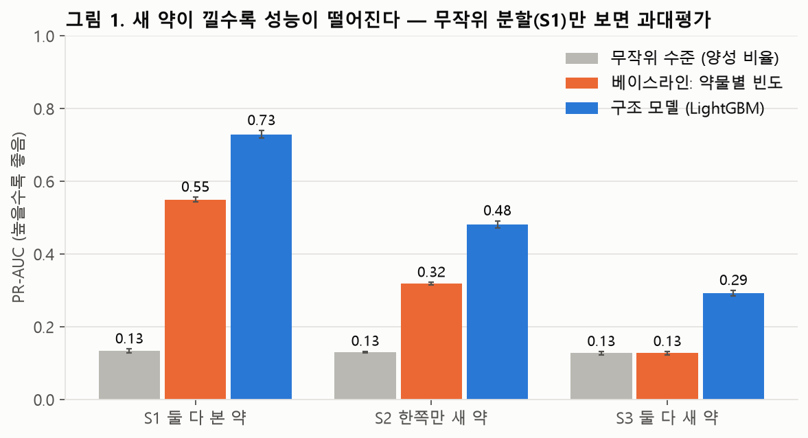
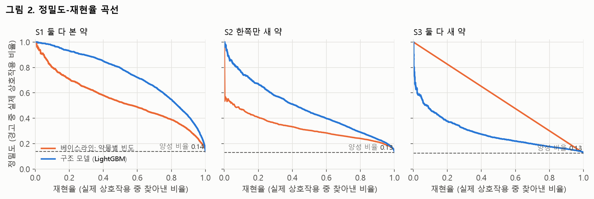

# 구조 기반 약물 상호작용(DDI) 예측 모델

PillCheck의 판정은 등록된 조합을 조회하는 방식임(자체 규칙 데이터, 옵션으로 식약처 DUR). 이 모듈은 그 방식의 빈틈인 "DB에 등록되지 않은 조합"을 두 약물의 분자 구조(SMILES)만으로 예측할 수 있는지 실험한 것임.

> 위치와 범위: 서비스와 별도로 진행한 후속 실험임. 서비스 엔진(`packages/shared`)에는 연결하지 않았고, 판정을 대체하지 않음. 학습 데이터는 DUR이 아니라 공개 데이터인 DrugBank DDI임.

| 항목 | 내용 |
|---|---|
| 문제 | 두 약물의 SMILES → 상호작용으로 등록된 쌍인지 여부 (이진 분류) |
| 데이터 | DrugBank DDI (TDC 배포본): 약물 1,705개, 상호작용 쌍 191,392개 |
| 피처 | Morgan 지문 1,024비트 × 2 → 순서에 무관한 쌍 피처 2,048차원 |
| 모델 | LightGBM, 베이스라인 2종과 비교 |
| 주요 결과 | PR-AUC 0.73 (둘 다 본 약) → 0.48 (한쪽만 새 약) → 0.29 (둘 다 새 약). 양성 비율 0.13 |

수치 가운데 데이터 정제 건수(2.1절), 지문 통계, 다운로드 크기, 소요 시간은 스크립트 실행 때 나온 값으로 저장소에 결과 파일이 없음 (기록). 성능 지표는 `results/metrics_summary.csv`, 분할 크기는 `results/split_info.json`에 있음.

---

## 1. 문제 정의

### DUR 조회 방식의 한계

DUR은 검증된 금기 조합을 정확히 알려 주지만 등록된 조합만 알려 줌.

- 새로 허가된 약은 상호작용 정보가 쌓일 때까지 목록이 비어 있음.
- 약이 N개면 가능한 조합은 N(N−1)/2개인데, 임상적으로 확인된 조합은 그 일부임. 이 데이터에서도 1,705개 약물의 가능한 조합 145만 쌍 중 등록된 것은 13.2%임.
- 조회 결과가 없을 때 "안전하다"와 "아직 모른다"를 구분할 수 없음.

### 접근

약물 상호작용의 상당수는 대사 효소 억제나 같은 수용체 작용처럼 분자 구조와 관련된 기전에서 나옴. 그래서 구조만으로 "이미 알려진 상호작용 쌍과 닮은 조합"을 가려낼 수 있는지 확인함. 구조는 신약에도 항상 존재하므로, 상호작용 정보가 전혀 없는 약에도 적용할 수 있다는 것이 장점임.

목표는 판정이 아니라 우선순위 신호임. "DUR에 없지만 구조상 검토해 볼 만한 조합"을 사람에게 올려 주는 용도를 상정함.

---

## 2. 데이터와 피처

### 2.1 데이터

| 단계 | 건수 |
|---|---|
| 원본 행 | 191,808 |
| 약물 수 | 1,706 |
| 해석할 수 없는 SMILES로 제외한 약물 | 1 (관련 행 10개) |
| 같은 쌍이 상호작용 유형만 달리해 중복된 행 | 406 |
| 최종 약물 / 양성 쌍 | 1,705 / 191,392 |
| 가능한 전체 쌍 | 1,452,660 |
| 양성 비율 | 13.18% |

- 출처: [Therapeutics Data Commons, DrugBank DDI](https://tdcommons.ai/multi_pred_tasks/ddi/). 로그인이나 키 없이 받을 수 있음. 원 데이터는 DrugBank이며 비상업적 용도로 제공됨. 저장소에는 데이터를 포함하지 않고 스크립트가 내려받음.
- 라벨 정의: 등록된 쌍 = 1, 등록되지 않은 쌍 = 0. 원본에는 상호작용 유형이 86종 있지만 "있다/없다"로 단순화함.
- 음성 라벨의 의미: 0은 "상호작용이 없다고 확인됨"이 아니라 "등록되지 않음"임. 실제로는 상호작용이 있지만 아직 등록되지 않은 쌍이 음성에 섞여 있음. 이 한계는 [5장](#5-한계와-다음-단계)에서 다시 다룸.

### 2.2 피처 설계

**약물 1개 → Morgan 지문 (반경 2, 1,024비트)**

분자의 각 원자를 중심으로 2결합 이내의 부분 구조를 뽑아 "있다/없다"로 표시한 벡터임(ECFP4에 해당). 약물 하나당 평균 43.5개 비트가 켜짐.

- 상호작용 기전이 작용기·고리 같은 부분 구조와 관련이 깊기 때문에 선택함.
- 분자 크기와 무관하게 길이가 같아 표 형태 모델에 바로 넣을 수 있음.
- 구조만 있으면 계산되므로 새 약에도 적용됨.

**약물 쌍 → 순서에 무관한 2,048차원**

| 구간 | 계산 | 의미 |
|---|---|---|
| 앞 1,024칸 | `a + b` | 0 = 둘 다 없음, 1 = 한쪽만, 2 = 둘 다 있음 |
| 뒤 1,024칸 | `|a − b|` | 1 = 한쪽에만 있는 구조 |

두 지문을 단순히 이어 붙이면 (A, B)와 (B, A)가 서로 다른 입력이 되어, 같은 약물 쌍인데 입력 순서에 따라 예측이 달라질 수 있음. 합과 차의 절댓값은 순서를 바꿔도 값이 같으므로 데이터를 두 배로 늘리지 않고도 대칭성이 보장됨. `predict.py`는 실행할 때마다 두 순서의 결과가 같은지 확인함.

---

## 3. 평가 설계

### 3.1 분할: 쌍이 아니라 약물 단위로

이 문제에서 가장 조심해야 하는 부분임. 쌍을 무작위로 나누면 시험 세트의 거의 모든 약물이 학습 세트에도 등장함. 그러면 모델은 구조를 이해하지 않고도 "이 약은 원래 상호작용이 많다"는 것만 외워서 높은 점수를 받을 수 있고, 그 점수를 "새 조합 예측 성능"이라고 보고하면 과대평가가 됨.

그래서 약물을 먼저 학습 70% / 검증 10% / 시험 20%로 나누고, 평가를 세 상황으로 분리함.

| 상황 | 시험 쌍의 구성 | 현실에서의 의미 |
|---|---|---|
| S1 둘 다 본 약 | 학습 약물 × 학습 약물 중 학습에 쓰지 않은 쌍 | 기존 약끼리의 미등록 조합 (무작위 분할과 같은 조건) |
| S2 한쪽만 새 약 | 학습 약물 × 시험 약물 | 신약을 기존 약과 함께 쓰는 경우 |
| S3 둘 다 새 약 | 시험 약물 × 시험 약물 | 가장 어려운 경우 |

- 학습 300,000쌍, 검증 40,000쌍, S1 60,000쌍, S2 60,000쌍, S3 약 58,000쌍(전체).
- 약물 분할을 시드 3개로 반복해 평균과 표준편차를 냄. 시험 약물이 340개 정도라 분할에 따라 결과가 흔들릴 수 있기 때문임.

### 3.2 데이터 누수 점검

| 점검 항목 | 조치 |
|---|---|
| 같은 쌍이 방향·유형만 달리해 중복 | (A,B)와 (B,A)를 통일한 뒤 중복 406건 제거 |
| 같은 구조가 다른 ID로 등록 | 지문이 완전히 같은 약물 28개를 그룹으로 묶어 항상 같은 분할에 배치 (`GroupShuffleSplit`) |
| 학습 쌍과 S1 시험 쌍의 겹침 | 한 번 섞어서 자르는 방식으로 분리, 실행 시 `assert`로 확인 |
| 학습 쌍에 검증·시험 약물 혼입 | 실행 시 `assert`로 확인 |
| 임계값·조기 종료를 시험 세트로 결정 | 검증 세트에서만 결정 |
| 베이스라인의 약물별 빈도 계산 | 학습 쌍만 사용 |

### 3.3 불균형과 지표

양성이 13%이므로 전부 "상호작용 없음"이라고 답해도 정확도가 87%가 나옴. 정확도로는 모델을 평가할 수 없어서 다음과 같이 정함.

- 주 지표: PR-AUC. 양성 비율이 낮을 때 ROC-AUC는 음성이 많다는 이유만으로 높게 나오는 경향이 있음. PR-AUC는 아무 정보 없이 찍으면 양성 비율(0.13)이 되므로 기준선이 분명함.
- 보조 지표: ROC-AUC, 정밀도, 재현율, F1. 임계값은 검증 세트에서 F1이 최대인 지점으로 정함.
- 표본은 무작위로 뽑아 양성 비율을 실제 분포 그대로 유지함. 음성을 줄여 1:1로 맞추면 지표가 좋아 보이지만 실제 사용 환경의 정밀도와 달라짐.

### 3.4 베이스라인

| 이름 | 방법 | 비교 목적 |
|---|---|---|
| 무작위 수준 | 모든 쌍에 양성 비율을 점수로 부여 | 아무것도 학습하지 않았을 때의 바닥 |
| 약물별 빈도 | 각 약물이 학습 데이터에서 상호작용한 비율만 사용 (구조 미사용, 로지스틱 회귀) | 구조 없이 "상호작용이 많은 약"이라는 정보만으로 얻는 성능 |

구조 모델이 빈도 베이스라인을 넘지 못하면 구조를 학습했다고 말할 수 없으므로, 빈도 베이스라인을 비교 기준으로 둠.

---

## 4. 결과

### 4.1 상황별 성능 (시드 3개 평균)



| 상황 | 양성 비율 | 무작위 수준 | 빈도 베이스라인 | 구조 모델 | 베이스라인 대비 |
|---|---|---|---|---|---|
| S1 둘 다 본 약 | 0.133 | 0.133 | 0.549 | 0.729 | +0.180 |
| S2 한쪽만 새 약 | 0.130 | 0.130 | 0.318 | 0.481 | +0.163 |
| S3 둘 다 새 약 | 0.127 | 0.127 | 0.127 | 0.292 | +0.165 |

(값은 PR-AUC)

구조 모델의 나머지 지표:

| 상황 | ROC-AUC | 정밀도 | 재현율 | F1 | 정확도 | 전부 음성일 때 정확도 |
|---|---|---|---|---|---|---|
| S1 | 0.929 | 0.558 | 0.779 | 0.649 | 0.888 | 0.867 |
| S2 | 0.839 | 0.435 | 0.555 | 0.486 | 0.847 | 0.870 |
| S3 | 0.716 | 0.320 | 0.332 | 0.323 | 0.824 | 0.873 |

### 4.2 해석

1. 구조에는 신호가 있음. 세 상황 모두에서 구조 모델이 빈도 베이스라인보다 PR-AUC가 0.16~0.18 높음. S3에서는 빈도 베이스라인이 무작위 수준(0.127)으로 떨어지는데 구조 모델은 0.292로 그 2.3배임.
2. 무작위 분할 점수는 과대평가임. S1의 0.729만 보고하면 쓸 만해 보이지만, 문제 정의에 해당하는 "새 약" 상황에서는 0.481, 0.292로 떨어짐. S1 성능의 상당 부분은 구조가 아니라 약물 자체를 기억해서 나온 것이고, 빈도 베이스라인이 S1에서 0.549가 나오는 것이 그 근거임.
3. 정확도는 판단 기준이 되지 못함. S2와 S3에서 모델의 정확도(0.847, 0.824)는 전부 음성이라고 답했을 때(0.870, 0.873)보다 낮음. 그런데도 모델은 실제 상호작용의 33~56%를 찾아내고, 전부 음성 전략은 하나도 찾지 못함.
4. 지금 수준으로는 판정에 쓸 수 없음. S3에서 정밀도 0.32는 경고 3건 중 2건이 등록되지 않은 조합이라는 뜻임. 사람이 검토할 후보를 추리는 용도로만 의미가 있음.



### 4.3 불균형 처리 비교

양성에 가중치(음성 수 ÷ 양성 수 ≈ 6.5배)를 준 모델과 주지 않은 모델을 비교함.

| S1 기준 | 재현율 (임계값 0.5) | 정밀도 (임계값 0.5) | 조정한 임계값 | F1 (조정 후) | PR-AUC |
|---|---|---|---|---|---|
| 가중치 없음 | 0.431 | 0.822 | 0.226 | 0.649 | 0.729 |
| 가중치 있음 | 0.854 | 0.453 | 0.555 | 0.613 | 0.676 |

- 임계값을 0.5로 고정하면 가중치 없는 모델은 양성의 43%만 찾음. 가중치를 주면 85%로 올라감.
- 그러나 순위를 매기는 능력(PR-AUC)은 가중치가 없는 쪽이 세 상황 모두에서 높았고, 임계값을 검증 세트에서 조정하면 F1도 더 높았음.
- 그래서 가중치 없이 학습하고 임계값을 조정하는 방식을 최종으로 택함. 불균형 문제의 상당 부분은 학습 방법이 아니라 임계값 선택의 문제였음.

실험 중 겪은 문제도 기록해 둠. 처음에 가중치 모델이 트리 1개에서 학습을 멈춤. 조기 종료가 PR-AUC가 아니라 기본 지표인 logloss를 기준으로 삼았는데, 가중치를 주면 예측 확률이 전체적으로 올라가 검증 logloss가 처음부터 나빠졌기 때문임. 조기 종료 지표를 PR-AUC로 고정해 해결함.

---

## 5. 한계와 다음 단계

**한계**

- 음성 라벨이 불확실함. 등록되지 않은 쌍을 음성으로 취급했기 때문에, 모델이 맞게 경고한 미등록 상호작용이 오답으로 계산됨. 정밀도는 실제보다 낮게 측정되었을 수 있고, 모델은 "등록될 만한 조합"을 학습한 것이지 "위험한 조합"을 학습한 것이 아님.
- DUR이 아닌 DrugBank로 학습함. DrugBank의 상호작용은 경미한 것까지 포함하고, DUR 병용금기는 그중 심각한 일부임. 이 모델의 점수를 DUR 금기 가능성으로 읽을 수 없음.
- 상호작용의 종류와 심각도를 구분하지 않음. 86종을 하나로 합침.
- 구조만으로는 설명되지 않는 상호작용이 있음. 구조가 전혀 다른 두 약이 같은 효소로 대사되는 경우처럼, 표적·효소·수송체 정보가 있어야 잡을 수 있는 기전이 있음. 새 약에서 성능이 떨어지는 주된 이유로 봄.
- 확률 보정을 하지 않음. 점수 0.7이 "70% 확률"을 뜻하지 않음.
- 임상 검증이 없음. 예측 결과를 약사나 문헌으로 확인하는 절차를 거치지 않음.

**다음 단계**

- DUR 병용금기 성분쌍을 SMILES에 매핑해, 심각한 상호작용만을 양성으로 하는 평가 세트 구성
- 대사 효소(CYP)·표적 단백질 정보를 피처에 추가해 S2·S3 성능 개선 여부 확인
- 상호작용 유형별 다중 분류, 유형별 불균형(가장 흔한 유형 6만 건 대 드문 유형 10건 미만) 처리
- 음성 라벨 불확실성을 다루는 학습 방법(positive-unlabeled learning) 적용
- 약물 구조의 골격(scaffold) 기준 분할로 더 엄격한 일반화 평가
- 확률 보정 후, DUR 조회 결과가 없는 조합에 한해 "검토 권장" 신호로 연결하는 방식 검토

---

## 6. 실행 방법

```bash
cd ml/ddi-structure-model
pip install -r requirements.txt

python src/01_prepare_data.py       # 데이터 다운로드(약 44MB), 정제, 지문 계산
python src/02_train_evaluate.py     # 분할 → 베이스라인 → 학습 → 평가 → 그림 (시드 3개, 약 10분)
python src/02_train_evaluate.py --seeds 0   # 시드 1개만 빠르게

# 두 약물의 SMILES로 점수 확인 (예: 와파린 + 이부프로펜)
python src/predict.py "CC(=O)CC(C1=CC=CC=C1)C1=C(O)C2=CC=CC=C2OC1=O" "CC(C)CC1=CC=C(C=C1)C(C)C(O)=O"
```

```text
ml/ddi-structure-model/
├── src/
│   ├── common.py              # 경로, 지문 계산, 쌍 피처 함수
│   ├── 01_prepare_data.py     # 다운로드·정제·지문 계산
│   ├── 02_train_evaluate.py   # 분할·베이스라인·학습·평가·그림
│   └── predict.py             # 두 SMILES → 점수 (연구용 데모)
├── results/
│   ├── metrics_summary.csv    # 시드 평균·표준편차
│   ├── metrics_by_seed.csv    # 시드별 전체 지표
│   ├── split_info.json        # 시드별 약물·쌍 수
│   └── fig1, fig2 *.png
├── data/                      # (커밋 제외) 스크립트가 생성
└── models/                    # (커밋 제외) 학습된 모델
```

## 작업 범위

PillCheck의 조회 방식이 가진 빈틈에서 출발해 문제 정의부터 평가까지 진행함. 설계 검토와 코드 작성에 Claude Code를 사용함.
